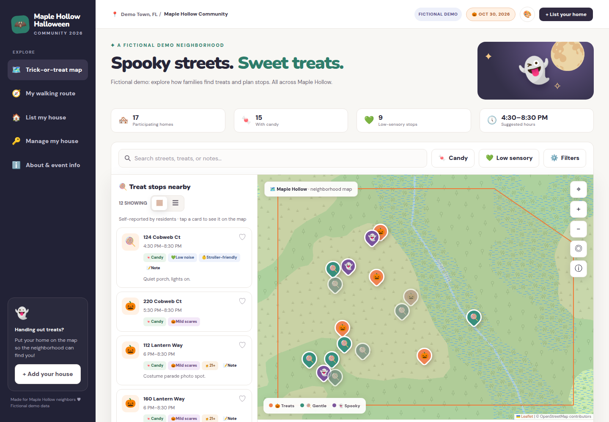
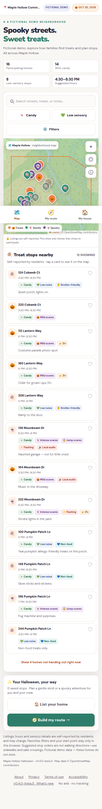
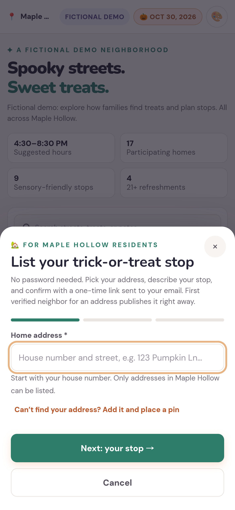

# Neighborhood events map

A small, self-hosted map of the homes taking part in a neighborhood event, for **one neighborhood per install**. The first supported event is **Halloween trick-or-treating**: families browse a mobile-friendly map of homes that chose to participate — candy, non-food treats, 21+ refreshments, sensory notes, hours and live status — and plan a list of stops. Residents list their own home with a one-time email link (no passwords); the first verified neighbor for an address publishes it immediately. Organizers configure everything (name, event name, logo, colours, date, time zone, boundary, optional zones) without touching code. Since 0.12 the same install can also run a **Christmas lights** season: homes pick their nights and hours, visitors filter for drive-by homes, music or no flashing reported and plan a lights tour ([organizer checklist](docs/runbooks/christmas-lights.md)). Since 0.13 it can run a **garage or rummage sale**: homes pick their sale days with their own hours, categories and payment kinds, visitors filter by category, open now or sale day and plan their sale stops, and notes never carry contact details ([organizer checklist](docs/runbooks/garage-sale.md)). See the [roadmap](ROADMAP.md).

**Status:** `0.13.0-beta.1` (pre-release; PHP 8.5, Symfony 8.1, PostgreSQL 18) — feature-complete beta with light and dark appearance; all automated gates pass locally and in GitHub Actions. **Not production-approved yet**: see [Before going live](#before-going-live).

| Desktop | Mobile | Listing a home |
|---|---|---|
|  |  |  |

Screenshots use the **fictional** “Maple Hollow” demo community (invented homes placed in an uninhabited forest). The repository also ships a **real-data example**, [Ventura Reserve in Orlando, FL](#real-data-example-ventura-reserve-orlando-fl), built from official county plats.

## Features

- **Families (no account):** map + list kept in sync, address/notes search, zone and walking-area filter, candy / sensory-friendly / no big scares / no flashing / no loud audio / non-food / 21+ / stroller / open-now / visit-at filters (all conjunctive, saved per event in the browser), favorites, suggested stop order split into separate trips per walkable area right under the map, named saved routes (each with its own homes and filters, kept on the device), share link, a map that stays on the neighborhood, “Report this listing”, works as a plain list if the map fails. No tracking; location never leaves the device.
- **Residents:** pick an address from the private registry (or allow-listed street + pin), describe the stop, confirm by email. Links last 15 minutes, work once and are consumed only by an explicit POST (email scanners cannot burn them). Dashboard to change hours, offerings, status (“Out of candy”, “Paused”, “Done”), hide/unhide, or give up the home. A claim stays with the resident across events; each event's listing is separate (“List for <event>” starts from an empty form). Signed-in sessions end after **30 minutes of inactivity**, enforced on the server.
- **Already-claimed homes:** clear notice and a review request (proof-of-work + rate limits) emailed to the organizer; the current owner is never revealed.
- **Organizers:** setup checklist, events (prepare the next one as a draft, preview it, switch the map to it in one step, end it, export or delete an old event's listings), community/branding/event/zones settings, Leaflet.draw boundary & zone editor with GeoJSON import/export and approval gate, address registry (CSV import, manual add/edit — coordinates are never guessed), claim transfer/unclaim, listing hide/unhide, review requests, audit log, private CSV export.
- **Safety:** browser SHA-256 proof-of-work + persistent PostgreSQL rate limits on every email-sending endpoint, honeypot fields, a sign-in reply that is identical in content and timing for known and unknown emails, nginx request limits, CSRF + Origin checks, strict CSP (no inline script/style), atomic “first verified email wins” claims enforced by a database primary key, owner-scoped resident queries, a per-resident home limit, server-side point-in-polygon geofencing, no public address roster, tokens never logged, hardened least-privilege containers. Audit and hardening results: [docs/security/hardening-report.md](docs/security/hardening-report.md).

Built with **PHP 8.5 / Symfony 8.1, PostgreSQL 18, Twig, vanilla JavaScript/CSS, Leaflet (OpenStreetMap tiles), Docker Compose**. No PostGIS, no Node build step, no paid services.

## Quick start (local, ~10 minutes)

Requirements: Docker with Compose v2, `openssl`.

```bash
git clone https://github.com/<owner>/neighborhood-events-map.git && cd neighborhood-events-map
cp .env.example .env
```

Edit `.env`: set `APP_SECRET` and `POSTGRES_PASSWORD` (`openssl rand -hex 32`), uncomment `COMPOSE_FILE=compose.yaml:compose.dev.yaml` for local development (adds Mailpit), and pick a community:

```bash
# fictional demo community with demo homes (development only)
echo 'COMMUNITY_BOOTSTRAP_FILE=/app/examples/demo/community.yaml' >> .env
echo 'COMMUNITY_BOOTSTRAP_APPROVE=1' >> .env
echo 'APP_DEMO=1' >> .env
```

```bash
docker compose run --rm --no-deps --entrypoint composer app install   # dev overlay only (bind-mounted source)
docker compose up -d --build --wait
docker compose exec app php bin/console app:admin:grant you@example.org   # or list it in ORGANIZER_EMAILS in .env
```

- Site: <http://localhost:8087> · Mailpit (all email in dev): <http://localhost:8025>
- Organizer console: <http://localhost:8087/admin> (sign in at `/login` with the granted email; the link arrives in Mailpit)

Production-style run (no dev overlay, baked image, non-root PHP, unprivileged nginx): leave `COMPOSE_FILE` unset and run `docker compose pull && docker compose up -d` to use the published images (amd64 and arm64; pin `APP_IMAGE_TAG` to a release), or `docker compose up -d --build` to build from source. See [deployment](docs/runbooks/deployment.md).

## Configure your own neighborhood

Nothing neighborhood-specific lives in code. Start from [`config/community.example.yaml`](config/community.example.yaml):

1. Copy it to `deploy/community/community.yaml` and set name, locality, time zone, event name/date/hours, colours/emoji/logo, features and (optionally) zones.
2. Boundary: put a reviewed GeoJSON (`[longitude, latitude]`, Polygon/MultiPolygon/FeatureCollection) next to it and reference it as `map.boundary_file`, **or** leave it empty and draw it in **Organizer → Boundary & zones**. Never trace coordinates from a screenshot. Disconnected areas are fine.
3. Set `COMMUNITY_BOOTSTRAP_FILE=/app/deploy/community/community.yaml` in `.env` and start the stack (imported once; later edits happen in the console and can be exported with `bin/console app:community:export <dir>`).
4. In the console, check the outline against real streets and press **Approve boundary**. House listings stay closed until you do.
5. Addresses: import a reviewed CSV (`address,latitude,longitude,zone_key`) in **Addresses & claims** or with `bin/console app:addresses:import file.csv --dry-run`, or enable self-entry with a street allow-list (`registration.address_mode: self_entry|both`). With `registration.review_new_addresses: true`, homes residents add themselves wait for your approval (Overview lists them; approve on Addresses & claims).
6. Areas without homes yet: give the zone `status: coming_soon` (drawn with that label, not listable) or `hidden`; switch it to `active` when houses are built.

Four communities ship with the code and run unchanged from it: the fictional, zone-less Halloween demo ([`examples/demo/`](examples/demo/)), the same fictional neighborhood as a Christmas lights season ([`examples/demo-lights/`](examples/demo-lights/)) and as a rummage sale ([`examples/demo-sale/`](examples/demo-sale/)), and the zoned real-plat example ([`examples/ventura-reserve/`](examples/ventura-reserve/)). Keep your own neighborhood's files under the git-ignored `deploy/` folder, not in `examples/`.

Full guide: [docs/runbooks/setup.md](docs/runbooks/setup.md).

## Real-data example: Ventura Reserve (Orlando, FL)

[`examples/ventura-reserve/`](examples/ventura-reserve/) is a small, real subdivision in the City of Orlando, used to check the whole pipeline against official data. Its three recorded plats (Phases 1–3) come from Orange County's open-data map service (Subdivision layer, maintained by the Orange County Property Appraiser) and were downloaded with the generic importer:

```bash
python3 scripts/fetch_arcgis_boundaries.py --config examples/ventura-reserve/gis-sources.json   # plats -> zones, boundary, manifest, review map
python3 scripts/fetch_arcgis_addresses.py  --config examples/ventura-reserve/gis-sources.json   # address points -> deploy/private/ventura-reserve-example/ (never committed)
```

The boundary imports **pending review**, exactly like a new deployment. No resident data is in the repository: there are no listings or claims, and the address inventory is fetched to the git-ignored `deploy/private/` folder only when you run the second command. To try registration end to end, import that CSV with `bin/console app:addresses:import` and approve the boundary in the console. Provenance and data notes: [examples/ventura-reserve/README.md](examples/ventura-reserve/README.md). For your own county, copy [`examples/gis-sources.example.json`](examples/gis-sources.example.json).

## Deploying (any Docker host behind HTTPS)

nginx listens only on `127.0.0.1:${HTTP_PORT}` (default 8087); PostgreSQL has no published port. Point an HTTPS reverse proxy or tunnel (Caddy, nginx, Traefik, Cloudflare Tunnel …) at `http://127.0.0.1:8087`, set `APP_BASE_URL=https://your-hostname` and a real SMTP relay in `MAILER_DSN`. Step by step: [docs/runbooks/deployment.md](docs/runbooks/deployment.md); an optional Cloudflare example is in [docs/examples/cloudflare.md](docs/examples/cloudflare.md). Backups run daily (`backup` service, 14-day retention); restore with `bin/restore.sh` — see [docs/runbooks/backup-restore.md](docs/runbooks/backup-restore.md). Upgrades/rollback: [docs/runbooks/upgrade-rollback.md](docs/runbooks/upgrade-rollback.md). Event day (Halloween night): [docs/runbooks/event-day.md](docs/runbooks/event-day.md).

## Testing

```bash
docker compose exec app sh bin/test.sh                     # PHPUnit: unit + integration on PostgreSQL
docker compose exec app vendor/bin/phpstan analyse         # static analysis (level 6)
docker run --rm -v "$PWD":/w -w /w node:24-alpine node --test tests/js/*.test.mjs
docker run --rm -v "$PWD":/w -w /w python:3.14-slim sh -c "pip install -q shapely==2.2.0 && python -I -m unittest discover -s scripts/tests"
./bin/e2e.sh                                               # Playwright E2E against the Ventura Reserve, demo, lights demo and sale demo stacks
python3 scripts/smoke_session.py                           # session lifecycle smoke test on the running stack
```

The same gates run in GitHub Actions ([.github/workflows/ci.yml](.github/workflows/ci.yml)). Current results are recorded in [docs/quality/test-report.md](docs/quality/test-report.md).

## Before going live

Production readiness is blocked on real-world inputs, not code:

- For each deployment: the organizer's approval of the boundary and zones, and a review of the address inventory (county address points; border cases).
- Production hostname, an HTTPS proxy or tunnel, and a deliverability-tested SMTP relay.
- Verified safe pedestrian crossings before enabling any routing groups/provider.
- The published container images must be public on GitHub Container Registry for `docker compose pull` to work without signing in.

## Privacy and accessibility

No ads and no tracking; no analytics unless the operator turns on cookie-free Cloudflare Web Analytics (`CLOUDFLARE_WEB_ANALYTICS`, off by default; the privacy page and footer then say so). The privacy page lists every cookie and storage the site uses, including Cloudflare's security cookies when Cloudflare delivers the site (`CLOUDFLARE_PROXY`); everything is strictly necessary or stays on the device, so there is no cookie banner. Public pages set no cookies of their own, and the only cookie is the sign-in session after a resident confirms a link. Favorites and filters stay in the visitor's browser. Every page links a privacy notice (`/privacy`), terms of use (`/terms`) and an accessibility statement (`/accessibility`); set `community.contact_url` (e.g. `mailto:`) so visitors can reach the organizer. The UI targets WCAG 2.1 AA and is checked automatically (axe-core) in light and dark; colour is never the only signal. These pages describe the software's behaviour — they are not legal advice.

## Important limitation

Claiming is **first verified email wins**. Controlling an email address is not proof of living at or owning a home; mistakes and abuse are handled by the organizer through review requests, transfers and hiding. This is an intentional product choice.

## Documentation

[Roadmap](ROADMAP.md) · [Architecture](docs/architecture/overview.md) · [Decisions (ADRs)](docs/adr/) · [Security policy](SECURITY.md) · [Contributing](CONTRIBUTING.md) · [Code of conduct](CODE_OF_CONDUCT.md) · [Agent/developer protocol](AGENTS.md) · [Changelog](CHANGELOG.md) · [Release process](docs/runbooks/release.md) · [Public-readiness audit](docs/quality/public-readiness-audit.md)

## License

[MIT](LICENSE). Map data © OpenStreetMap contributors. Fonts: Nunito and DM Sans (SIL OFL 1.1). Leaflet (BSD-2-Clause), Leaflet.draw (MIT).
